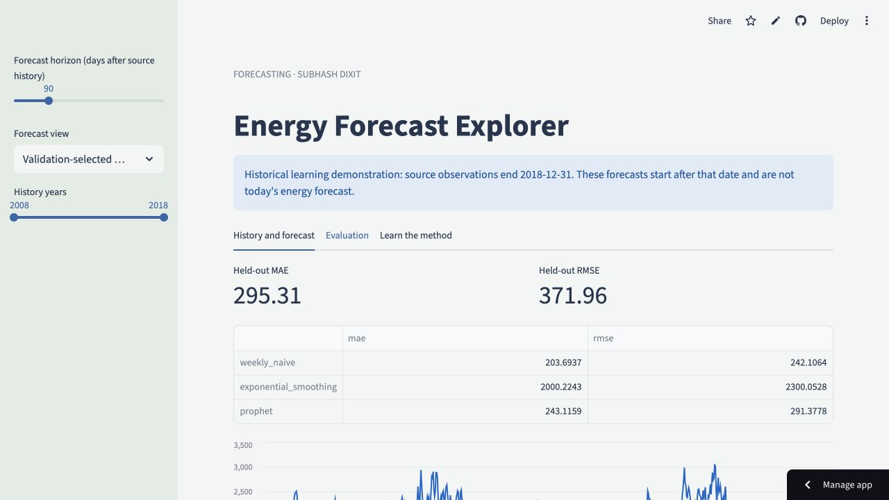
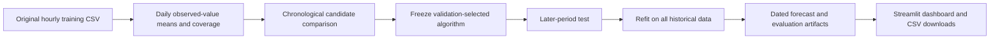
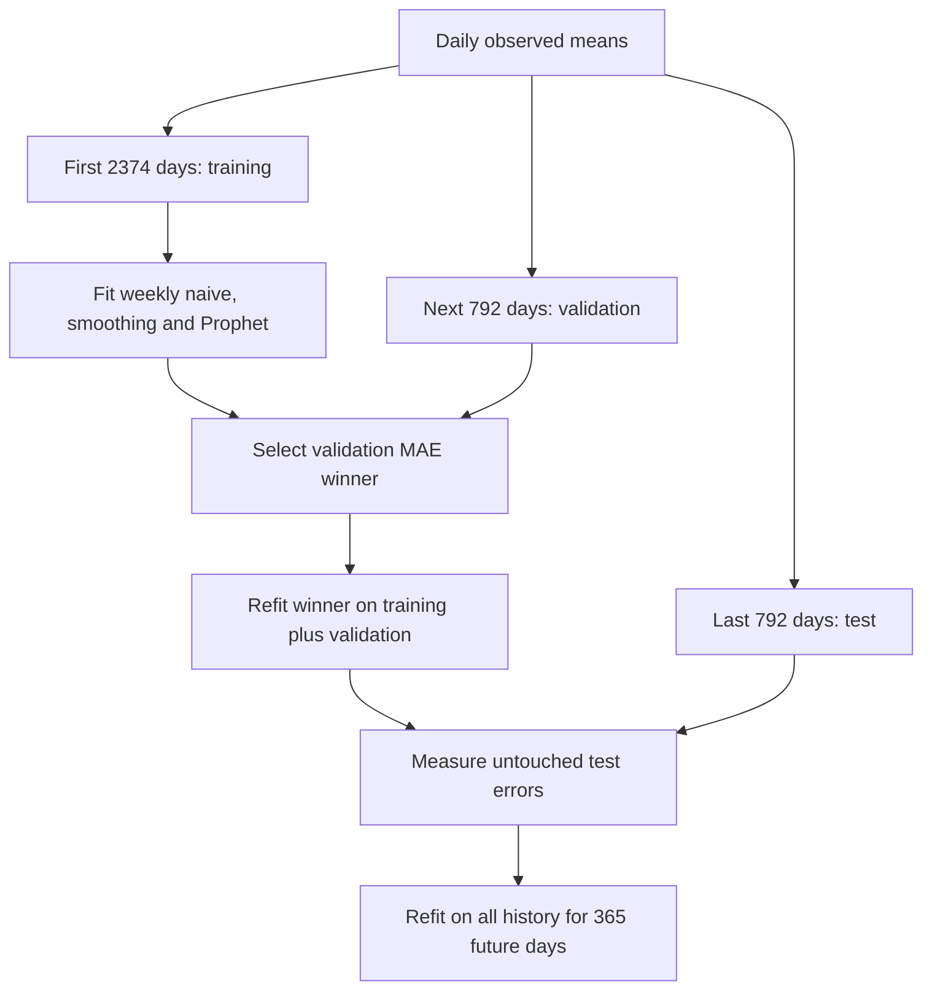
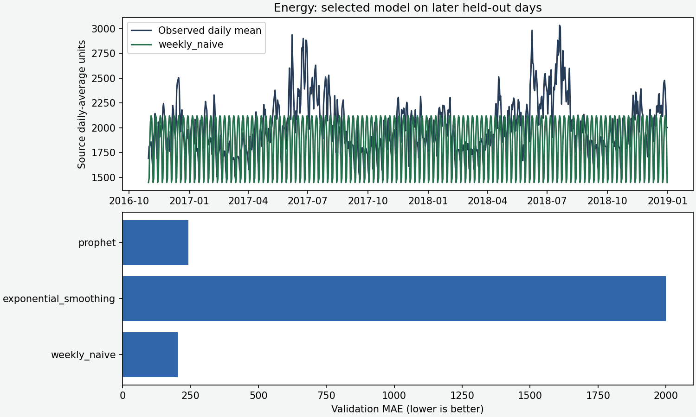
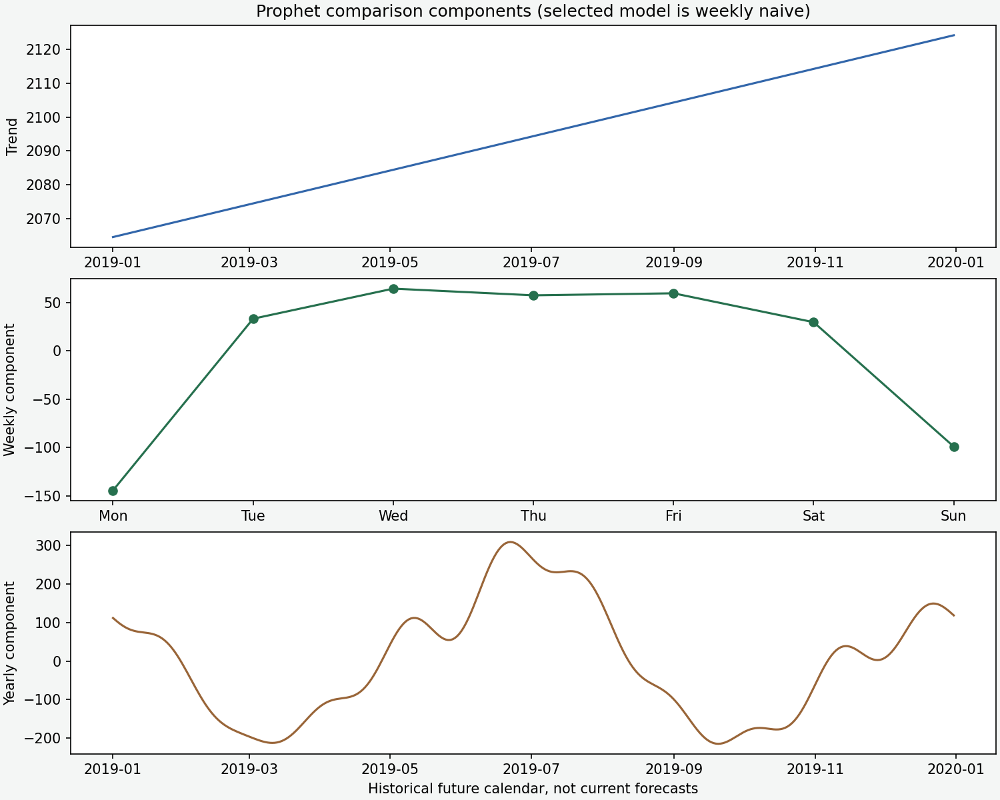

# Energy Forecast Explorer

**Live application:** [Open Energy Demand Forecaster](https://subhash-energy-forecast.streamlit.app/)

An end-to-end **historical daily-average energy forecasting dashboard** built with Streamlit. Compare a weekly-naive baseline, exponential smoothing and Prophet, inspect later-period errors, explore model-based uncertainty and download forecast horizons.

Heavy fitting runs offline. The deployed interface serves reviewed forecast artifacts, so opening a page does not start Stan or retrain a model.

> Source history ends **31 December 2018**. The dashboard's forecasts are anchored after that historical cutoff; they are not current energy predictions. Source units and renewable-energy composition are undocumented. This is a learning resource, not a live grid-planning service.



## What we built and why

The original project used Prophet for an hourly energy challenge and exported a three-year forecast. The new app provides a transparent **daily-average** learning task with chronological model comparison, explicit missing-data coverage, measured evaluation and a fast interface. This is a documented change in granularity, not an assertion that the original hourly submission has been reproduced unchanged.

The original notebook, CSVs and three-year export remain preserved. [The original README](archive/original_README.md) is available. The original export has row IDs rather than a verified calendar index; the new dashboard uses its own dated, reproducible daily forecasts.

| Dashboard area | What you learn |
|---|---|
| History and forecast | Filter historical years, select 7–365 forecast days and download results |
| Selected model versus Prophet | See the validation winner and the separate Prophet comparison |
| Evaluation | Read validation MAE/RMSE and later held-out actual-versus-forecast lines |
| Method | Understand aggregation, missing observations, time order, baselines and uncertainty |

## Architecture



The application package contains data aggregation and metric functions. A separate script fits models and writes artifacts. The interface reads those artifacts and offers views/downloads. No Prophet/Stan installation is required in the serving dependency set; `requirements-training.txt` adds the offline training tools.

This illustrates batch inference: predictions are computed ahead of time and then served. It is appropriate for a fixed historical learning study. A live forecasting service would need authorized fresh data ingestion, retraining schedules, monitoring and a defined update policy, which this app does not claim to provide.

## Run locally

Use Python 3.10 or 3.11; select Python 3.11 for Community Cloud.

```bash
git clone https://github.com/subhashdixit/energy-demand-forecaster.git
cd energy-demand-forecaster
python3 -m venv .venv
source .venv/bin/activate
python -m pip install --upgrade pip
pip install -r requirements-dev.txt
python -m pip check
streamlit run streamlit_app.py
```

On Windows, activate with `.venv\Scripts\Activate.ps1`. Open [http://localhost:8501](http://localhost:8501). Committed artifacts are sufficient to use the dashboard; you do not need to rerun training.

## Use the application

1. Inspect the historical cutoff notice and the daily mean series.
2. Adjust the history-year range to explore earlier/later observations.
3. Choose a forecast horizon between 7 and 365 days after the source cutoff.
4. Select **Validation-selected model** or **Prophet comparison**.
5. Read forecast values and any nominal interval lines, then download the visible CSV.
6. Open **Evaluation** to inspect actual-versus-predicted values and candidate errors.
7. Read the missing-hour coverage warning before interpreting daily means.

The horizon slider changes the displayed subset of a precomputed 365-day forecast. It does not claim new data has arrived or trigger a new fit. Prophet's interval belongs to its comparison forecast; it must not be attached to the selected weekly-naive forecast as if both shared an uncertainty model.

## Data, aggregation and missingness

The source `train_IxoE5JN.csv` contains **94,992 hourly rows** and **1,900 missing energy values**. The preparation script validates unique timestamps, finite nonnegative observed values and daily target availability.

It aggregates **the mean of observed hourly values per calendar day**, creating **3,958 daily observations** from 1 March 2008 to 31 December 2018. It does not sum the values, infer a physical unit or impute missing hourly targets. **1,522 days** have fewer than 24 observed values; the minimum is 19.

That distinction matters: the mean of 19 observed hours can differ from the true 24-hour mean, especially if missingness is systematic. Reported coverage makes that limitation visible. A day with no observed target fails preparation rather than receiving a fabricated value.

Source timezone, collection processes, units, target-definition detail and independent redistribution rights are not established here. The file name and original project title do not establish that all values measure renewable generation. Original challenge test/submission files are retained, but they have no ground truth for a claimed evaluation.

## Reproduce offline training

```bash
pip install -r requirements-training.txt
python scripts/train.py
python scripts/plot_results.py
```

Training uses Prophet **1.5.0** and statsmodels **0.14.4**, with pinned direct requirements. Source SHA-256, aggregation details, partition counts and measured metrics are recorded in `reports/metrics.json`. Prophet is also retained as a JSON model artifact for inspection/reproduction, even when a simpler model wins.



Validation selects the algorithm; the final test does not. The selected algorithm is refitted on training plus validation before testing. After evaluation is recorded, full history is used only for forecasting beyond the last source date. This is one historical holdout, not rolling-origin cross-validation or evidence of current performance.

## Models: the story and tradeoffs

| Candidate | How it works | Advantage | Limitation |
|---|---|---|---|
| Weekly naive | Repeat the last seven daily values | Transparent and strong when weekly structure dominates | Cannot anticipate a changing long-term trend or unusual event |
| Exponential smoothing | Update level, additive trend and weekly seasonality | Smoothly adapts observed patterns | Trend extrapolation can drift badly over a long horizon |
| Prophet | Piecewise trend plus Fourier seasonal components and an error model | Flexible calendar patterns and model-based uncertainty | Assumptions about trend/seasonality and future change can fail; not automatically superior |

Prophet uses yearly and weekly seasonality, disables daily seasonality because the target is daily, and uses nominal interval width 0.8 with 300 uncertainty samples. No holiday calendar is invented. A data-derived seasonal pattern does not establish its causal mechanism.

A simple analogy: weekly naive reuses last week's timetable; smoothing updates the timetable gradually; Prophet separates a longer-term direction from recurring calendar patterns. A flexible timetable can still extrapolate the wrong direction.

## Measured results

| Validation candidate | MAE | RMSE |
|---|---:|---:|
| weekly naive | 203.694 | 242.106 |
| exponential smoothing | 2000.224 | 2300.053 |
| prophet | 243.116 | 291.378 |

**Weekly naive wins**, despite Prophet's greater complexity. It is refitted on development data and measured on the final **792 days**:

| Held-out metric | Result |
|---|---:|
| MAE | 295.311 |
| RMSE | 371.958 |





The components chart explains the fitted Prophet comparison; it is not proof that Prophet won. The selected model's test metrics must not be described as Prophet metrics.

**MAE** is the mean absolute error in source daily-average units. It communicates a typical absolute miss. **RMSE** squares errors first and penalizes large misses more strongly. Neither should be compared numerically with a different dataset's scale. Percentage errors require an independently justified denominator and are not included.

The long historical validation window exposes the smoothing model's poor trend extrapolation. The interface retains that comparison rather than silently showing only a favorable algorithm.

## Prediction intervals: useful but conditional

Prophet's lower/upper lines form a nominal **80% model-based interval**. They are not guaranteed to contain 80% of future observations. Coverage depends on modeling assumptions and the future resembling the processes represented in history. Structural breaks, systematic missingness and unusual events can invalidate that interpretation.

The selected weekly-naive model has no calibrated interval in this app. We do not borrow Prophet's interval for it. The published test metric concerns the selected model; no independent real-world uncertainty guarantee is claimed for either.

## Coding standards and tests

```bash
python -m black --check src tests scripts streamlit_app.py
# Install training requirements before linting the training/plotting modules:
python -m pylint src scripts streamlit_app.py
python -m pytest -q
python -m pip check
```

Tests check observed-value aggregation, missing targets, duplicate timestamps, negative/infinite measurements, weekly-baseline arithmetic, metric definitions, artifact totals and rendered dashboard views using Streamlit AppTest. The app tests load prepared artifacts; they do not start Stan.

Functions handle stateless transformations. Streamlit handles the interface; offline scripts handle fitting. This keeps modeling, presentation and deployment concerns independently reviewable.

## Deployment: platform-managed updates without a custom CI workflow

This repository intentionally demonstrates **no custom GitHub Actions pipeline**. Run the local quality checks, review changes and merge a verified revision. Community Cloud then manages deployment from the linked branch. That automatic publishing is still CD; omitting a workflow file does not mean updates are entirely manual.

1. Sign in to Streamlit Community Cloud and connect GitHub.
2. Select `subhashdixit/energy-demand-forecaster`, branch `main`.
3. Set entry file `streamlit_app.py` and Python **3.11**.
4. Deploy; confirm the cutoff notice, both forecast views, evaluation and downloads.

`requirements.txt` installs only serving dependencies. Heavy training requirements stay separate. Hosting supplies the running app and URL; deployment selects and installs a repository version.

Benefits are simple hosting, fast artifact-driven page loads and little server configuration. Tradeoffs include resource limits, platform sleep behavior, less server control and reliance on manual local verification before merge. See [Community Cloud documentation](https://docs.streamlit.io/deploy/streamlit-community-cloud).

## Versioning, retraining and rollback

Model/report version, Git revision, source hash, training dependencies and dated forecast files describe a release together. Retraining creates new forecast artifacts; deployment publishes them. They are separate actions.

For an update, install the training environment, verify new authorized source data, preserve the observation cutoff, prepare candidates, inspect validation/test behavior and commit matching artifacts/code. Changing aggregation changes the target and requires a clearly documented release.

To roll back, revert the problematic commit through a reviewed change so Community Cloud publishes the previous code and artifacts. Restarting the same broken revision is not a rollback. Keep earlier source hashes and reports; do not repeatedly use the same test period for tuning and still call it untouched.

## Repository map

```text
src/energy_forecast/core.py aggregation, coverage and error definitions
scripts/train.py           offline candidate fitting and evaluation
scripts/plot_results.py    reproducible documentation figures
streamlit_app.py           artifact-driven dashboard
reports/                   measured metrics, dated forecasts and Prophet JSON
requirements.txt           lightweight serving installation
requirements-training.txt  separate offline fitting environment
tests/                     domain, artifacts and AppTest checks
.streamlit/                theme and serving limits
archive/                   original README
Original CSVs/notebook     preserved source and earlier study
```

## Troubleshooting

If forecasts appear old, check the source cutoff: this is intentionally historical. If preparation fails for an empty day, investigate the missing target rather than silently filling a future evaluation value. If Prophet cannot initialize its Stan backend, confirm the pinned training environment and supported Python; serving existing reports does not need that backend. A successful page load does not establish useful forecasting performance.

## References

- [Prophet official project and releases](https://github.com/facebook/prophet)
- [Statsmodels time-series methods](https://www.statsmodels.org/stable/tsa.html)
- [Streamlit AppTest](https://docs.streamlit.io/develop/api-reference/app-testing)
- [Streamlit Community Cloud](https://docs.streamlit.io/deploy/streamlit-community-cloud)
